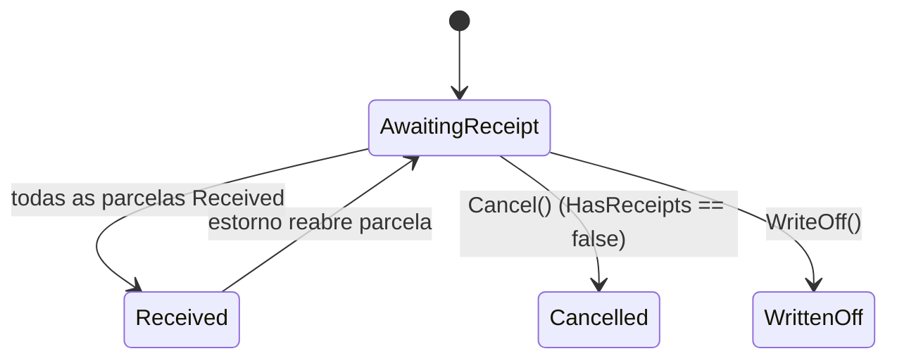
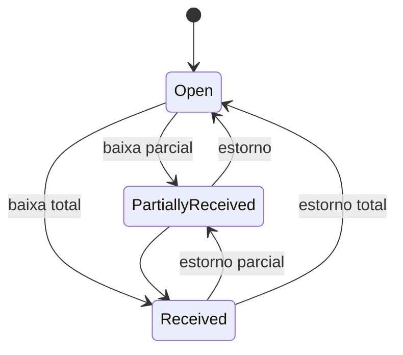
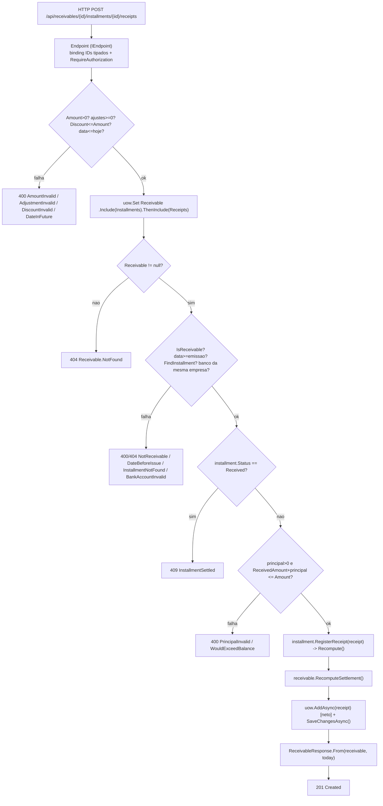
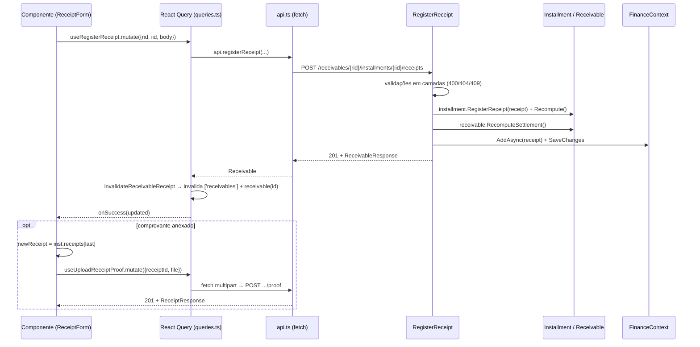

# AEL-450 — Contas a Receber: Arquitetura de Código (backend + frontend)

> Branch `AEL-450/contas-a-receber`. Documento **focado em código**: tipos, assinaturas,
> wiring entre camadas e fluxo de dados. Cobre **backend** (domínio → contratos → endpoints →
> persistência) e **frontend** (tipos → api → hooks → schemas → componentes → rotas).
> Espelha o padrão do Contas a Pagar (`docs/AEL-452-fluxo-baixa-contas-a-pagar.md`); §9 lista as
> diferenças de código.

Agregado de 3 níveis. O título nasce `AwaitingReceipt` (sem workflow de aprovação):

```
Receivable                 (raiz; IAuditable + ISoftDeletable)
└── ReceivableInstallment  (parcela; deriva ReceivedAmount/Status das baixas)
    └── Receipt            (baixa de entrada; reversível; metadados do comprovante)
        └── proof          (bytes no IFileStorageService; metadados no Receipt)
```

---

## 1. Mapa de arquivos por camada

| Camada | Arquivos (novos salvo indicação) |
|---|---|
| **IDs** (Common) | `Ids/ReceivableId.cs`, `Ids/ReceivableInstallmentId.cs`, `Ids/ReceiptId.cs` |
| **Domínio** | `Domain/Entities/Receivable.cs`, `ReceivableInstallment.cs`, `Receipt.cs`; `Domain/Enums.cs` *(alterado)* |
| **Contratos** | `Application/Contracts/ReceivableResponse.cs`, `ReceivableListItemResponse.cs`, `ReceivableInstallmentResponse.cs`, `ReceiptResponse.cs` |
| **Endpoints** | `Application/Endpoints/Receivables/{List,Get,Create,Update,Cancel}Receivable`, `RegisterReceipt`, `ReverseReceipt`, `{Upload,Download}ReceiptProof`, `ReceivableClock.cs`; `Application/FinanceEndpoints.cs` *(alterado)* |
| **Persistência** | migration `20260610195310_AddReceivablesAndReceipts`; `Infrastructure/Database/FinanceContext.cs` *(alterado)* |
| **Frontend** | `web/src/pages/contas-a-receber.tsx`; *(alterados)* `web/src/api.ts`, `web/src/queries.ts`, `web/src/pages/schemas.ts`, `web/src/api/schema.d.ts`, `web/openapi.json`, `web/src/i18n/locales/pt-BR.ts`, `web/src/App.tsx` |
| **Testes** | `tests/Ulbra.One.UnitTests/Finance/ReceiptTests.cs`, `tests/Ulbra.One.IntegrationTests/Finance/ReceivableEndpointsTests.cs` |

Reuso: `BankAccount` e o enum `PaymentMethod` (do Contas a Pagar) são compartilhados.

(Caminhos de backend relativos a `src/Modules/Finance/Ulbra.One.Finance.*/` e `src/Common/Ulbra.One.Common.Application/`.)

---

## 2. Backend — Domínio

### 2.1 `Receipt`  (`Domain/Entities/Receipt.cs`)

Campos `private set`; computed `PrincipalApplied`; dois métodos de mutação.

```csharp
public decimal PrincipalApplied => Amount - Interest - Fine + Discount;  // juros/multa não abatem; desconto abate

public void Reverse(Guid reversedById, DateTimeOffset at, string? reason)  // grava autoria do estorno
{
    if (IsReversed) throw new InvalidOperationException("Receipt is already reversed.");
    IsReversed = true; ReversedById = reversedById; ReversedAt = at; ReversalReason = reason;
}

public void SetProof(string fileName, string contentType, string storagePath, long sizeBytes) { ... }
```

Campos: `Id, InstallmentId, ReceivableId, ReceiptDate, Amount, BankAccountId, Method, Interest, Fine,
Discount, Notes, IsReversed, ReversalReason, Proof{FileName,ContentType,StoragePath,SizeBytes},
CreatedAt, CreatedById, ReversedAt?, ReversedById?`. Construtor recebe tudo menos os campos de proof/estorno.

### 2.2 `ReceivableInstallment`  (`Domain/Entities/ReceivableInstallment.cs`)

`ReceivedAmount`/`Status` são **derivados** — nunca setados direto. Toda mutação chama `Recompute()`.

```csharp
public Receipt RegisterReceipt(Receipt receipt)
{
    if (Status == ReceivableInstallmentStatus.Received)
        throw new InvalidOperationException("Installment is already settled.");
    if (ReceivedAmount + receipt.PrincipalApplied > Amount)                          // anti over-receipt
        throw new InvalidOperationException("Receipt would exceed the installment outstanding balance.");
    _receipts.Add(receipt); Recompute(); return receipt;
}

public void ReverseReceipt(Guid receiptId, Guid reversedById, DateTimeOffset at, string? reason)
{
    var receipt = _receipts.FirstOrDefault(r => r.Id == receiptId)
        ?? throw new InvalidOperationException("Receipt not found on this installment.");
    receipt.Reverse(reversedById, at, reason); Recompute();
}

private void Recompute()
{
    ReceivedAmount = _receipts.Where(r => !r.IsReversed).Sum(r => r.PrincipalApplied);
    Status = ReceivedAmount <= 0 ? ReceivableInstallmentStatus.Open
        : ReceivedAmount >= Amount ? ReceivableInstallmentStatus.Received
        : ReceivableInstallmentStatus.PartiallyReceived;
}
```

`_receipts` é `List<Receipt>` privado, exposto como `IReadOnlyList<Receipt> Receipts`.

### 2.3 `Receivable`  (`Domain/Entities/Receivable.cs`) — raiz do agregado

```csharp
public bool IsReceivable => Status is ReceivableStatus.AwaitingReceipt or ReceivableStatus.Received;
public bool HasReceipts => _installments.SelectMany(i => i.Receipts).Any(r => !r.IsReversed);

public void RecomputeSettlement()
{
    if (Status is ReceivableStatus.Cancelled or ReceivableStatus.WrittenOff) return;
    Status = _installments.All(i => i.Status == ReceivableInstallmentStatus.Received)
        ? ReceivableStatus.Received : ReceivableStatus.AwaitingReceipt;
}

public void Cancel(string? reason)   // exige status mutável E HasReceipts == false
public void WriteOff(string? reason) // exige status mutável (NÃO checa HasReceipts)
private void EnsureMutable()         // chamado por Update(): só AwaitingReceipt && !HasReceipts

public ReceivableInstallment? FindInstallment(Guid id) => _installments.FirstOrDefault(i => i.Id == id);
public Receipt? FindReceipt(Guid id) => _installments.SelectMany(i => i.Receipts).FirstOrDefault(r => r.Id == id);

// rateio: arredonda cada parcela; sobra na última; vencimentos somam intervalMonths
public static List<ReceivableInstallment> GenerateInstallments(decimal total, int count, DateOnly firstDueDate, int intervalMonths);
```

`SetInstallments(...)` (privado) recalcula `TotalAmount` e exige ≥ 1 parcela.

### 2.4 Enums e máquinas de estado  (`Domain/Enums.cs`)

```csharp
public enum ReceivableOrigin { Manual, AcademicImport, Rent, MiscRevenue }
public enum ReceivableStatus { AwaitingReceipt, Received, Cancelled, WrittenOff }
public enum ReceivableInstallmentStatus { Open, PartiallyReceived, Received }
// reuso: enum PaymentMethod { Pix, Ted, Boleto, Cash, DirectDebit, Other }
```





### 2.5 IDs tipados  (`Ids/Receivable*Id.cs`, `Ids/ReceiptId.cs`)

`readonly record struct` que implementa `IPrefixedId, IParsable<T>` — binding direto na rota.

```csharp
public readonly record struct ReceivableInstallmentId(Guid Value) : IPrefixedId, IParsable<ReceivableInstallmentId>
{
    public static string Prefix => "receivable_installment_";   // receivable_ / receipt_ nos outros
    public override string ToString() => Prefix + Value.ToString("N");
    public static bool TryParse(string? s, IFormatProvider? p, out ReceivableInstallmentId result) { ... } // aceita forma crua ou prefixada
}
```

A entidade guarda `Guid` puro; o tipo forte vive só na fronteira (rota/DTO).

---

## 3. Backend — Contratos (responses)

`sealed record` + `static From(...)`. Nunca expõe a entidade. (`Application/Contracts/`.)

```csharp
public sealed record ReceivableResponse(
    ReceivableId Id, CompanyId CompanyId, ReceivableOrigin Origin, CustomerId PayerId, string PayerName,
    string? DocumentNumber, DateOnly? IssueDate, string Description, CostCenterId CostCenterId,
    Guid? RevenueCategoryId, Guid? LedgerAccountId, decimal TotalAmount, ReceivableStatus Status,
    string? CancelReason, string? WriteOffReason, DateTimeOffset CreatedAt,
    IReadOnlyList<ReceivableInstallmentResponse> Installments);
    // From(r, today): Installments OrderBy(Sequence)

public sealed record ReceivableInstallmentResponse(
    ReceivableInstallmentId Id, int Sequence, DateOnly DueDate, decimal Amount, ReceivableInstallmentStatus Status,
    decimal ReceivedAmount, bool IsOverdue, int DaysOverdue, IReadOnlyList<ReceiptResponse> Receipts);
    // From(i, today): overdue = Status != Received && DueDate < today;
    //                 DaysOverdue = overdue ? today.DayNumber - DueDate.DayNumber : 0; Receipts OrderBy(CreatedAt)

public sealed record ReceiptResponse(
    ReceiptId Id, ReceivableInstallmentId InstallmentId, DateOnly ReceiptDate, decimal Amount, BankAccountId BankAccountId,
    PaymentMethod Method, decimal Interest, decimal Fine, decimal Discount, string? Notes, bool IsReversed,
    string? ReversalReason, DateTimeOffset? ReversedAt, bool HasProof, DateTimeOffset CreatedAt);
    // From(r): HasProof = r.ProofStoragePath != null   (caminho de storage nunca vai no fio)

public sealed record ReceivableListItemResponse(   // uma linha por PARCELA; sem árvore de receipts
    ReceivableId ReceivableId, ReceivableInstallmentId InstallmentId, int Sequence, int InstallmentCount,
    string PayerName, string Description, CostCenterId CostCenterId, Guid? RevenueCategoryId,
    DateOnly DueDate, decimal Amount, decimal ReceivedAmount, ReceivableInstallmentStatus InstallmentStatus,
    ReceivableStatus ReceivableStatus, bool IsOverdue);   // sem From(): projetado no endpoint
```

`today` vem de `ReceivableClock.Today(clock)` — `DateOnly` em UTC-3 fixo (Brasil, sem DST).

---

## 4. Backend — Endpoints  (`Application/Endpoints/Receivables/`, grupo `/api/receivables`)

Padrão `IEndpoint` (minimal API), `RequireAuthorization()`. Registrados em `FinanceEndpoints.cs`.

| Verbo + rota | Classe | Request | Response | Status |
|---|---|---|---|---|
| `GET /` | `ListReceivables` | query + `[AsParameters] PaginationQueryParameters` | `PaginatedResponse<ReceivableListItemResponse>` | 200 |
| `GET /{id}` | `GetReceivable` | — | `ReceivableResponse` | 200, 404 |
| `POST /` | `CreateReceivable` | `CreateReceivableRequest` | `ReceivableResponse` | 201, 400 |
| `PUT /{id}` | `UpdateReceivable` | `UpdateReceivableRequest` | `ReceivableResponse` | 200, 400, 404, 409 |
| `POST /{id}/cancel` | `CancelReceivable` | `CancelReceivableRequest(string? Reason)` | `ReceivableResponse` | 200, 404, 409 |
| `POST /{id}/installments/{installmentId}/receipts` | `RegisterReceipt` | `RegisterReceiptRequest` | `ReceivableResponse` | 201, 400, 404, 409 |
| `POST /{id}/receipts/{receiptId}/reverse` | `ReverseReceipt` | `ReverseReceiptRequest(string? Reason)` | `ReceivableResponse` | 200, 404, 409 |
| `POST /{id}/receipts/{receiptId}/proof` | `UploadReceiptProof` | `IFormFile` (multipart) | `ReceiptResponse` | 201, 400, 404 |
| `GET /{id}/receipts/{receiptId}/proof` | `DownloadReceiptProof` | — | arquivo (stream) | 200, 404 |

> `WriteOff` existe no domínio mas **não tem rota** mapeada em `FinanceEndpoints.cs`.

Requests com instalments (Create/Update):

```csharp
public sealed record InstallmentInput(DateOnly DueDate, decimal Amount);
public sealed record GenerateInput(decimal TotalAmount, int Count, DateOnly FirstDueDate, int IntervalMonths = 1);
// CreateReceivableRequest: CompanyId, PayerId(CustomerId), CostCenterId, RevenueCategoryId?, LedgerAccountId?,
//   Origin, [NormalizeText] Description, [NormalizeText] DocumentNumber?, IssueDate?, Installments? | Generate?
// UpdateReceivableRequest: idem, sem CompanyId/Origin
public sealed record RegisterReceiptRequest(
    DateOnly ReceiptDate, decimal Amount, BankAccountId BankAccountId, PaymentMethod Method,
    decimal Interest = 0, decimal Fine = 0, decimal Discount = 0, string? Notes = null);
```

### 4.1 `RegisterReceipt.Handle` — validação em camadas (ordem e código)

`Handle(ReceivableId id, ReceivableInstallmentId installmentId, RegisterReceiptRequest req, UserContext user,
[FromKeyedServices("finance")] IUnitOfWork uow, TimeProvider clock, CancellationToken ct)`

| # | Guard | Resposta |
|---|---|---|
| 1 | `Amount <= 0` | 400 `Receipt.AmountInvalid` |
| 2 | `Interest/Fine/Discount < 0` | 400 `Receipt.AdjustmentInvalid` |
| 3 | `Discount > Amount` | 400 `Receipt.DiscountInvalid` |
| 4 | `ReceiptDate > today` | 400 `Receipt.DateInFuture` |
| 5 | título == null | 404 `Receivable.NotFound` |
| 6 | `!IsReceivable` | 400 `Receivable.NotReceivable` |
| 7 | `ReceiptDate < IssueDate` | 400 `Receipt.DateBeforeIssue` |
| 8 | `FindInstallment == null` | 404 `Receivable.InstallmentNotFound` |
| 9 | `!AnyAsync(b.Id == bankId && b.CompanyId == r.CompanyId)` | 400 `Receipt.BankAccountInvalid` |
| 10 | `installment.Status == Received` | 409 `Receipt.InstallmentSettled` |
| 11 | `principalApplied <= 0` | 400 `Receipt.PrincipalInvalid` |
| 12 | `ReceivedAmount + principalApplied > Amount` | 400 `Receipt.WouldExceedBalance` |
| 13 | `RegisterReceipt` lança | 409 `Receipt.InstallmentSettled` |

```csharp
var receivable = await uow.Set<Receivable>()
    .Include(p => p.Installments).ThenInclude(i => i.Receipts)
    .FirstOrDefaultAsync(p => p.Id == id.Value, ct);
// ...guards...
var receipt = new Receipt(installment.Id, receivable.Id, req.ReceiptDate, req.Amount, req.BankAccountId.Value,
    req.Method, req.Interest, req.Fine, req.Discount, req.Notes, Guid.Parse(user.UserId), clock.GetUtcNow());
installment.RegisterReceipt(receipt);
receivable.RecomputeSettlement();
await uow.AddAsync(receipt, ct);   // explicit: grandchild not auto-inserted on aggregate update
await uow.SaveChangesAsync(ct);
return Results.Created($"/api/receivables/{id}", ReceivableResponse.From(receivable, today));
```

Notas de persistência (recorrentes nos handlers):

- **`AddAsync(receipt)` explícito** — a raiz carregada está `Modified`, não `Added`; adicionar à coleção
  em memória não insere o "neto". Mesma instância ⇒ EF reconcilia, não duplica.
- **`ReverseReceipt`** não chama `AddAsync` (só muda `IsReversed` ⇒ `SaveChanges` persiste o update).
- **`UpdateReceivable`** gere a coleção à mão (EF não rastreia o backing field `List<T>` privado):
  `var old = r.Installments.ToList(); r.Update(...); uow.RemoveRange(old); foreach(...) await uow.AddAsync(inst);`.
- **`CreateReceivable`** valida `CostCenter` (UoW `"core"`) e `CustomerEntity.Active` (UoW `"registry"`)
  por query — não há FK cross-context.
- **`ListReceivables`** projeta `SelectMany(p.Installments)` para um tipo anônimo de primitivos **antes**
  de `ToPaginatedAsync` (traduz a SQL sem materializar a árvore), depois embrulha os `Guid` em IDs tipados.

---

## 5. Backend — Persistência EF  (`Infrastructure/Database/FinanceContext.cs`)

`DbSet`s: `Receivables`, `ReceivableInstallments`, `Receipts`. Schema `finance`, snake_case, `decimal(18,2)`,
migration auto-aplicada (`20260610195310_AddReceivablesAndReceipts`).

```csharp
modelBuilder.Entity<Receivable>(e => {
    e.Property(x => x.PayerName).HasMaxLength(200).IsRequired();
    e.Property(x => x.Description).HasMaxLength(300).IsRequired();
    e.Property(x => x.TotalAmount).HasPrecision(18, 2);
    e.HasMany(x => x.Installments).WithOne().HasForeignKey(i => i.ReceivableId).OnDelete(DeleteBehavior.Cascade);
    // SEM AutoInclude em Installments (oposto do Payable) → lista projeta; Get/baixa fazem Include explícito
    e.HasIndex(x => x.CompanyId); e.HasIndex(x => x.CostCenterId); e.HasIndex(x => x.PayerId); e.HasIndex(x => x.Status);
    e.HasQueryFilter(x => x.DeletedAt == null);            // soft-delete
});
modelBuilder.Entity<ReceivableInstallment>(e => {
    e.Property(x => x.Amount).HasPrecision(18, 2); e.Property(x => x.ReceivedAmount).HasPrecision(18, 2);
    e.HasIndex(x => x.ReceivableId); e.HasIndex(x => x.DueDate); e.HasIndex(x => x.Status);
    e.HasMany(x => x.Receipts).WithOne().HasForeignKey(r => r.InstallmentId).OnDelete(DeleteBehavior.Cascade);
    e.Navigation(x => x.Receipts).AutoInclude();           // Receipts SIM auto-include
});
modelBuilder.Entity<Receipt>(e => {
    // Amount/Interest/Fine/Discount (18,2); Notes/ReversalReason(300); Proof* (260/120/300)
    e.HasIndex(x => x.InstallmentId); e.HasIndex(x => x.ReceivableId); e.HasIndex(x => x.BankAccountId);
});
```

Referências lógicas a Core/Registry (`CompanyId, PayerId, CostCenterId, RevenueCategoryId, LedgerAccountId,
BankAccountId`) são `Guid` sem FK — validadas por query na aplicação.

---

## 6. Frontend  (`web/src/`)

Fluxo de dados: **schema gerado → tipos (`api.ts`) → client (`api.ts`) → hooks React Query (`queries.ts`)
→ componentes (`pages/contas-a-receber.tsx`)**, com validação Zod (`pages/schemas.ts`) e rotas (`App.tsx`).

### 6.1 Tipos  (`api.ts`)

Derivados do OpenAPI gerado (`web/src/api/schema.d.ts`, vindo de `openapi.json`):

```ts
export type Receivable = Schemas['ReceivableResponse'];
export type ReceivableListItem = Schemas['ReceivableListItemResponse'];
export type ReceivableInstallment = Schemas['ReceivableInstallmentResponse'];
export type Receipt = Schemas['ReceiptResponse'];
export type ReceivableStatus = Schemas['ReceivableStatus'];                 // 'AwaitingReceipt' | 'Received' | 'Cancelled' | 'WrittenOff'
export type ReceivableInstallmentStatus = Schemas['ReceivableInstallmentStatus'];
```

Inputs manuais (corpo das mutações):

```ts
export interface ReceivableInput {
  companyId: string; payerId: string; costCenterId: string;
  revenueCategoryId?: string | null; ledgerAccountId?: string | null; origin?: ReceivableOrigin;
  description: string; documentNumber?: string | null; issueDate?: string | null;
  installments?: { dueDate: string; amount: number }[];
  generate?: { totalAmount: number; count: number; firstDueDate: string; intervalMonths?: number };
}
export interface RegisterReceiptInput {
  receiptDate: string; amount: number; bankAccountId: string; method: PaymentMethod;
  interest?: number; fine?: number; discount?: number; notes?: string | null;
}
```

### 6.2 Client  (`api.ts`, objeto `api`)

```ts
listReceivables: (params) => request<Paginated<ReceivableListItem>>(`/receivables?${q}`),  // q = URLSearchParams; Page/PageSize capitalizados
getReceivable:   (id) => request<Receivable>(`/receivables/${id}`),
createReceivable:(body: ReceivableInput) => request<Receivable>('/receivables', { method:'POST', ... }),
updateReceivable:(id, body: Omit<ReceivableInput,'origin'>) => request<Receivable>(`/receivables/${id}`, { method:'PUT', ... }),
cancelReceivable:(id, reason) => request<Receivable>(`/receivables/${id}/cancel`, { method:'POST', body: JSON.stringify({reason}) }),
registerReceipt: (rid, iid, body: RegisterReceiptInput) => request<Receivable>(`/receivables/${rid}/installments/${iid}/receipts`, {method:'POST', ...}),
reverseReceipt:  (rid, receiptId, reason) => request<Receivable>(`/receivables/${rid}/receipts/${receiptId}/reverse`, {method:'POST', ...}),
uploadReceiptProof: async (rid, receiptId, file) => { /* fetch cru + FormData; Bearer manual; o browser define o boundary */ },
downloadReceiptProofUrl: (rid, receiptId) => `${BASE_URL}/receivables/${rid}/receipts/${receiptId}/proof`,
```

Mutações de baixa retornam o **`Receivable` inteiro** (espelha o backend) — a UI lê o estado recalculado dali.

### 6.3 Hooks React Query  (`queries.ts`)

```ts
queryKeys.receivables = (params) => ['receivables', params];
queryKeys.receivable  = (id)     => ['receivable', id];

useReceivables(params, { enabled })  // useQuery → api.listReceivables
useReceivable(id)                    // useQuery → api.getReceivable

// mutações via useInvalidatingMutation(mutationFn, invalidate, options):
useCreateReceivable   → invalida ['receivables']                          (item ainda não existe)
useUpdateReceivable   → invalidateReceivable(qc, data)                    (listas + receivable(id))
useCancelReceivable   → invalidateReceivable(qc, data)
useRegisterReceipt    → invalidateReceivableReceipt(qc, vars.receivableId)
useReverseReceipt     → invalidateReceivableReceipt(qc, vars.receivableId)
useUploadReceiptProof → invalidateReceivableReceipt(qc, vars.receivableId)
```

Tanto `invalidateReceivable` quanto `invalidateReceivableReceipt` invalidam **a lista E o item** — o detalhe
sempre reflete o novo estado.

### 6.4 Validação Zod  (`pages/schemas.ts`) — mensagens são chaves i18n

```ts
export const receivableSchema = z.object({
  payerId, costCenterId, description (trim≥1), documentNumber, issueDate,
  mode: z.enum(['single','installments']),
  totalAmount: refine(Number(v) > 0, 'validation.amountPositive'),
  installmentCount, firstDueDate (≥1), intervalMonths,
}).superRefine((v, ctx) => { if (v.mode==='installments' && !(Number.isInteger(n) && n>=2)) addIssue('installmentCount'); });

export const receiptSchema = z.object({
  receiptDate(≥1), amount(>0), bankAccountId(≥1),
  method: z.enum(['Pix','Ted','Boleto','Cash','DirectDebit','Other']),
  interest, fine, discount: nonNegativeNumberString, notes,
});

// previewInstallments(total, count, firstDue, intervalMonths): espelha o GenerateInstallments do domínio
// (arredonda cada parcela, sobra na última, soma intervalMonths) — usado só para o preview da UI.
```

### 6.5 Componentes  (`pages/contas-a-receber.tsx`)

Quatro componentes de rota + auxiliares:

```
ContasReceberPage          (lista; filtro overdueOnly; linha por parcela → navega ao detalhe)
NovaContaReceberPage  ─┐
EditarContaReceberPage ┴─→ ReceivableForm   (create/edit; mode single|installments; preview de parcelas)
ContaReceberDetailPage     (cards; tabela de parcelas; botão "Receber" por parcela; cancelar)
                            ├─ ReceiptForm     (registra baixa; encadeia upload do comprovante)
                            └─ ReceiptHistory  (por parcela: download comprovante / estorno)
auxiliares: ReceivableStatusBadge, ReceivableInstallmentStatusBadge, OverdueBadge, CustomerPicker
```

**Gate de edição** (espelha `EnsureMutable` do backend):

```tsx
const hasReceipts = r.installments.some((i) => i.receipts.some((rc) => !rc.isReversed));
const editable = r.status === 'AwaitingReceipt' && !hasReceipts;   // controla botões Editar/Cancelar
// botão "Receber" por parcela: r.status === 'AwaitingReceipt' && inst.status !== 'Received'
```

**`ReceiptForm` — baixa + upload encadeado** (depende do backend retornar o `Receivable` e dos receipts
ordenados por `CreatedAt`):

```tsx
const remaining = Math.round((installment.amount - installment.receivedAmount) * 100) / 100;  // pré-preenche amount
// ...
register.mutate({ receivableId, installmentId, body }, {
  onSuccess: (updated) => {
    if (file) {
      const inst = updated.installments.find((i) => i.id === installment.id);
      const newReceipt = inst?.receipts[inst.receipts.length - 1];   // último = mais recente
      if (newReceipt) { uploadProof.mutate({ receivableId, receiptId: newReceipt.id, file }, { onSuccess: onDone }); return; }
    }
    onDone();
  },
});
```

⚠️ Duas requisições não-atômicas: se o upload falhar, a baixa persiste sem comprovante (ambos os erros exibidos).

**Download do comprovante** — `fetch` autenticado → `blob` → object URL → clique programático (um `<a href>`
simples não carregaria o `Bearer`).

### 6.6 Rotas  (`App.tsx`)

```tsx
<Route path='contas-a-receber'            element={<ContasReceberPage />} />
<Route path='contas-a-receber/novo'       element={<NovaContaReceberPage />} />
<Route path='contas-a-receber/:id'        element={<ContaReceberDetailPage />} />
<Route path='contas-a-receber/:id/editar' element={<EditarContaReceberPage />} />
```

---

## 7. Fluxograma do processamento no backend (RegisterReceipt)



---

## 8. Fluxo end-to-end full-stack



**Estados resultantes:**

| Evento | Parcela | Título |
|---|---|---|
| Baixa parcial | `PartiallyReceived` | `AwaitingReceipt` |
| Baixa total (todas as parcelas) | `Received` | `Received` |
| Estorno | `Open` / `PartiallyReceived` | `AwaitingReceipt` |
| Cancelar (sem baixas) | — | `Cancelled` |
| WriteOff (só domínio) | — | `WrittenOff` |

---

## 9. Diferenças de código vs. Contas a Pagar

| Ponto | Payable | Receivable |
|---|---|---|
| Enum de status | `PayableStatus { PendingApproval, Approved, Rejected, Cancelled, Settled }` | `ReceivableStatus { AwaitingReceipt, Received, Cancelled, WrittenOff }` |
| Baixa | `Payment` / `RegisterPayment` | `Receipt` / `RegisterReceipt` |
| Assinatura do estorno | `Reverse(string? reason)` | `Reverse(Guid reversedById, DateTimeOffset at, string? reason)` |
| Auto-include de parcelas | `Navigation(Installments).AutoInclude()` | **ausente** (Include explícito; lista projetada) |
| Anti over-receipt | — (só guarda de status) | `if (ReceivedAmount + PrincipalApplied > Amount) throw` |
| Validação de data | livre | `DateInFuture` + `DateBeforeIssue` |
| Contraparte / categoria | `VendorId` / `categoryId` | `PayerId(CustomerId, valida Active)` / `RevenueCategoryId + LedgerAccountId` |
| `PrincipalApplied` | `Amount - Interest - Fine + Discount` | **idêntico** |
| Invalidação de cache (FE) | `invalidatePayablePayment` | `invalidateReceivableReceipt` (mesmo shape) |

Notas de código abertas (iguais ao Pagar): sem `rowversion`/optimistic lock; `Guid.Parse(user.UserId)`;
upload de comprovante não-atômico; `BankAccount` é referência (não movimenta saldo).

---

## 10. Referência rápida — arquivos-chave

| Item | Arquivo |
|---|---|
| `PrincipalApplied`, `Reverse` | `src/Modules/Finance/Ulbra.One.Finance.Domain/Entities/Receipt.cs` |
| `RegisterReceipt`, `Recompute` | `src/Modules/Finance/Ulbra.One.Finance.Domain/Entities/ReceivableInstallment.cs` |
| `RecomputeSettlement`, `Cancel`, `WriteOff`, `EnsureMutable` | `src/Modules/Finance/Ulbra.One.Finance.Domain/Entities/Receivable.cs` |
| Enums | `src/Modules/Finance/Ulbra.One.Finance.Domain/Enums.cs` |
| Responses (`From`) | `src/Modules/Finance/Ulbra.One.Finance.Application/Contracts/Receivable*Response.cs`, `ReceiptResponse.cs` |
| Endpoint da baixa | `src/Modules/Finance/Ulbra.One.Finance.Application/Endpoints/Receivables/RegisterReceipt/RegisterReceipt.cs` |
| Estorno | `src/Modules/Finance/Ulbra.One.Finance.Application/Endpoints/Receivables/ReverseReceipt/ReverseReceipt.cs` |
| Lista (projeção) | `src/Modules/Finance/Ulbra.One.Finance.Application/Endpoints/Receivables/ListReceivables/ListReceivables.cs` |
| Relógio Brasil | `src/Modules/Finance/Ulbra.One.Finance.Application/Endpoints/Receivables/ReceivableClock.cs` |
| Registro de rotas | `src/Modules/Finance/Ulbra.One.Finance.Application/FinanceEndpoints.cs` |
| Mapeamento EF + índices | `src/Modules/Finance/Ulbra.One.Finance.Infrastructure/Database/FinanceContext.cs` |
| IDs tipados | `src/Common/Ulbra.One.Common.Application/Ids/{ReceivableId,ReceivableInstallmentId,ReceiptId}.cs` |
| Tipos + client FE | `web/src/api.ts` |
| Hooks React Query | `web/src/queries.ts` |
| Schemas Zod + preview | `web/src/pages/schemas.ts` |
| Página (componentes) | `web/src/pages/contas-a-receber.tsx` |
| Rotas | `web/src/App.tsx` |
| Testes | `tests/Ulbra.One.UnitTests/Finance/ReceiptTests.cs`, `tests/Ulbra.One.IntegrationTests/Finance/ReceivableEndpointsTests.cs` |
